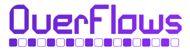

# Projetos Colaboradores

Conheça os projetos que colaboram com o FACOMpetindo e compartilham o compromisso de fortalecer a comunidade de programação competitiva.

## Overflows

<figure><figcaption></figcaption></figure>

A **[Overflows](https://www.overflows.com.br/)** é uma plataforma web gamificada, desenvolvida no Instituto Federal do Piauí (IFPI), que busca incentivar a prática de programação e tornar o aprendizado de algoritmos e estruturas de dados mais envolvente.

A plataforma reúne recursos para a prática de programação competitiva, incluindo um ambiente integrado para submissão e avaliação de soluções, competições, rankings, acompanhamento de desempenho e uma biblioteca de materiais de estudo.

Com uma proposta voltada à aprendizagem contínua, a Overflows busca aproximar estudantes da programação competitiva por meio de desafios, atividades práticas e elementos de gamificação. O projeto também recebeu a Chancela da Sociedade Brasileira de Computação (SBC), reconhecendo sua contribuição à área de Computação.

**Acesse:** [www.overflows.com.br](https://www.overflows.com.br/)
